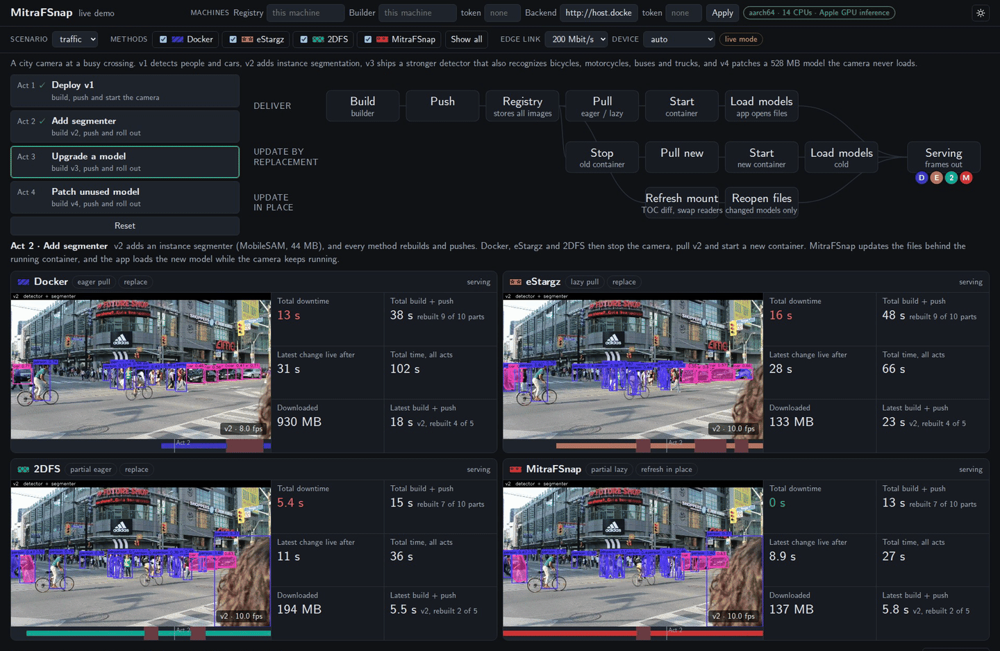

<p align="center">
  <a href="https://mitrafsnap.github.io"></a>
  <a href="https://github.com/mitrafsnap/demo"></a>
</p>

# MitraFSnap live demo

> Part of **MitraFSnap**, Build Less, Pull Less, Restart Never: Fast Container Image
> Distribution and In-Place Updates. The paper is under review.
> [Project page, videos and results](https://mitrafsnap.github.io)

This demo deploys and updates one vision application in four ways at the same time. Docker,
eStargz, 2DFS and [MitraFSnap](https://mitrafsnap.github.io) build the same image, deploy it
over the same emulated edge link and roll out the same updates while a camera stream runs. The
dashboard shows the video of each method, its position in the workflow, and live charts of the
time and data each update costs.



The excerpt above shows Act 3 at real speed. Docker, eStargz and 2DFS stop their containers to
roll out a new detector. MitraFSnap updates the files behind the running container, and its
camera never stops.

Both scenarios are also recorded in full, with all four acts and all four methods. Each video
starts with a short description of the acts and plays at 2x speed.

- [Traffic camera (MP4)](docs/traffic.mp4) and its [GIF excerpt](docs/traffic-highlight.gif)
- [People camera (MP4)](docs/people.mp4) and its [GIF excerpt](docs/people-highlight.gif)

The videos in the repository are 1280 px wide. `tools/encode.sh` also writes full resolution
versions, which we do not commit.

| Repository | Role in MitraFSnap |
|---|---|
| [builder](https://github.com/mitrafsnap/builder) | builds independent, lazy loadable allotments and their chunk indexes |
| [registry](https://github.com/mitrafsnap/registry) | turns a partition selection into prefetch hints over the complete image |
| [snapshotter](https://github.com/mitrafsnap/snapshotter) | lazy pulling and refresh of running containers |
| **demo** (this repository) | live demo that compares Docker, eStargz, 2DFS and MitraFSnap |
| [evaluation](https://github.com/mitrafsnap/evaluation) | build, pull and update benchmarks |

## Scenarios and acts

The dashboard offers two scenarios, and both run the same four acts.

The traffic scenario is a city camera at a busy crossing, played from a recorded clip. Version 1
detects people and cars. Version 2 adds instance segmentation with MobileSAM. Version 3 ships a
stronger detector that also recognizes bicycles, motorcycles, buses and trucks. Version 4
patches a 528 MB model that the camera never loads.

The people scenario watches people through your webcam, or through a recorded clip until you
turn the webcam on. Version 1 finds faces, version 2 adds body pose, version 3 ships an
expression model that labels smiles, and version 4 patches the same unused model.

| Act | All methods | MitraFSnap |
|---|---|---|
| 1. Deploy v1 | build v1, push it and start the camera | starts before the image is downloaded and fetches only the files the app reads |
| 2. Add a model | rebuild, push and roll out v2 | rebuilds one allotment and updates the running container |
| 3. Upgrade a model | rebuild, push and roll out v3 | rebuilds one allotment and updates the running container |
| 4. Patch an unused model | rebuild, push and roll out v4 | fetches only the new file index of the changed layer |

Docker and eStargz rebuild on every update. BuildKit keeps the cached layers before the
changed one, but the Dockerfile adds one layer per model in the order the models were
introduced, so a change invalidates every layer after it. 2DFS and MitraFSnap rebuild only the
allotment of the changed model. Each lane card shows how many layers or allotments the builds
rebuilt.

### Measurements

All numbers on the dashboard come from the same event times. The definitions are in
`measure()` in [dashboard/app.js](dashboard/app.js), and
[tools/summary.py](tools/summary.py) applies the same ones to a recorded trace.

- The time until a change is live runs from the start of an act, when the build begins, to the
  first frame of the new version. For Act 1 it ends at the first frame of the lane.
- Downtime counts the gaps of more than one second without output inside that interval.
  Shorter gaps occur when a busy machine delivers a frame late.
- The total time is the sum of the time until a change is live over the four acts.
- The total build and push time sums the build and push of every version.
- The download counts the bytes a lane pulled over the emulated link.

We ran the traffic scenario with all four methods at once on a MacBook Pro with an Apple M4 Pro
(10 performance and 4 efficiency cores, 20 GPU cores, 48 GB of memory) and macOS 26.6. The
backend ran in Docker Desktop 29.1, whose Linux VM had 14 CPUs and 8 GB of memory, the models
ran on the Apple GPU through the helper, and the emulated link was set to 200 Mbit/s.

| | Docker | eStargz | 2DFS | MitraFSnap |
|---|---:|---:|---:|---:|
| Act 1, until the first frame | 71.4 s | 37.8 s | 24.8 s | **18.5 s** |
| Act 2, until the segmenter is live | 30.9 s | 28.4 s | 10.9 s | **8.9 s** |
| Act 3, until the new detector is live | 37.5 s | 35.2 s | 13.3 s | **13.0 s** |
| Act 4, until the patch is live | 77.2 s | 46.7 s | 23.9 s | **17.9 s** |
| Total downtime, Acts 2 to 4 | 79.1 s | 37.1 s | 12.9 s | **0 s** |
| Total time, all acts | 217.1 s | 148.1 s | 72.9 s | **58.4 s** |
| Total build and push | 86.7 s | 108.8 s | 45.3 s | **39.5 s** |
| Downloaded | 1475 MB | 680 MB | 227 MB | **173 MB** |

The people scenario gives the same order. MitraFSnap has no downtime and needs 52.5 s in total,
compared with 252.1 s for Docker, 145.6 s for eStargz and 70.4 s for 2DFS.

The four methods share the CPU, the GPU and the link of one machine in this mode, so these
numbers illustrate the behavior of each method and should not be read as a benchmark. The
paper evaluates each method in isolation.

## Running the demo

The demo needs Docker with privileged containers and `/dev/fuse`. Docker Desktop on macOS and
Docker Engine on Linux (x86_64 or arm64) both work. Four lanes need about 15 GB of disk and
8 GB of memory, and two lanes need about half of that.

```sh
git clone https://github.com/mitrafsnap/demo.git
cd demo
tools/accel/run.sh              # macOS only, in a separate terminal, runs the models on the GPU
docker compose up -d            # starts the backend
```

The first start builds the two images of the backend. It compiles the MitraFSnap snapshotter,
builder and registry from their repositories and takes a few minutes. Later starts reuse these
images and take seconds. After pulling a new version of this repository, rebuild them with
`docker compose up -d --build`. The dashboard is at <http://localhost:8080>.

1. Choose a scenario and the methods to show. The dashboard shows Docker and MitraFSnap by
   default, and "Show all" adds eStargz and 2DFS.
2. Run Act 1 to Act 4 in order. An act ends when every lane shows its result. Act 1 always
   starts from a clean state. The first Act 1 also downloads the models and the clip (about
   1.3 GB) and builds the base images, which takes several minutes.
3. Reset clears all lanes, images and caches.

The edge link setting limits the bandwidth between the registry and the lanes, and a lower
value makes the differences easier to see. To use your webcam, select the people scenario and
click "Use my webcam". Browsers allow the camera only on `https` or `localhost` pages.

### Stopping the demo

```sh
docker compose down       # stops the backend and keeps models, images and caches
docker compose down -v    # also deletes the downloaded models and the caches
```

The Apple GPU helper stops with Ctrl-C in its terminal, and `docker compose ps` lists what is
still running. Neither command removes the two built images, so the next `docker compose up -d`
starts without a build. `docker compose down --rmi local` removes them as well.

### GPUs

The device setting defaults to `auto`, which runs the models on a GPU when the backend has one
and on the CPU otherwise. The other options force the Apple GPU, an NVIDIA GPU or the CPU, and
a device the backend does not have is greyed out. A new choice takes effect at the next Act 1,
and the status label at the top right shows the device in use.

Docker Desktop runs containers in a Linux VM without GPU access. On a Mac, `tools/accel/run.sh`
therefore starts a small helper on macOS itself, which executes the models with the CoreML
provider of ONNX Runtime. The lanes still read every model file from their own container mount,
so lazy fetching and refresh behave exactly as without the helper, and only the computation
moves to the GPU. Act 1 compiles every model once, so no update pays the CoreML compile time.

On a machine with an NVIDIA GPU and the
[NVIDIA Container Toolkit](https://docs.nvidia.com/datacenter/cloud-native/container-toolkit/),
start the backend with the GPU override.

```sh
docker compose -f compose.yaml -f compose.gpu.yaml up -d
```

The lane runtime then uses ONNX Runtime 1.31 with CUDA 13, so the host needs a driver that
supports CUDA 13. This should cover the DGX Spark (arm64) and x86 servers with A100 or H100
GPUs. We have not tested the NVIDIA mode on hardware yet. Jetson boards need NVIDIA's own ONNX
Runtime builds and the JetPack libraries, and therefore a different lane base image, which the
demo does not provide yet.

### Running the parts on separate machines

By default the whole demo runs on one machine. The backend, the registry and the builder can
each move to another machine, and every machine runs the same stack with
`docker compose up -d`. The Machines row at the top of the dashboard has one field for
each of them. An empty field means the machine that serves the dashboard, and Apply takes
effect for all three at once.

The backend runs the lanes, plays the camera feed and coordinates the acts, and the dashboard
talks to it through the Backend field. To reach a backend on another machine, for example a
DGX Spark next to the camera, start it with a token.

```sh
DEMO_BIND=0.0.0.0 DEMO_TOKEN=choose-a-secret docker compose up -d
```

Then open `http://<machine>:8080/?token=choose-a-secret`, or enter the URL and the token in the
Backend fields. An SSH tunnel (`ssh -L 8080:localhost:8080 <machine>`) also works, and it is the
simplest way to use a webcam with a remote backend.

The Registry field takes the `host:port` of a registry that both the backend and the builder
can reach. Any machine running the demo can serve as the registry if it was started with
`DEMO_REGISTRY_BIND=0.0.0.0`. The Builder field takes the URL of another machine running the
demo, with its `DEMO_TOKEN` if it has one. The backend then sends the base image preparation
and every build to that machine and streams the build phases back into the dashboard.

The edge link emulation applies only when the registry runs on the backend's machine. With a
remote registry the lanes pull over the real network, the edge link setting shows "real
network", and the demo still counts the downloaded bytes of each method. A change to the
machines takes effect at the next Act 1.

### Command line

```sh
tools/demo.py lanes docker estargz twodfs mitrafsnap    # choose the methods
tools/demo.py act deploy add-model upgrade patch       # run the four acts
tools/demo.py trace | tools/summary.py                  # numbers per lane
```

`tools/demo.py set 'scenario="people"'` switches the scenario, and `DEMO_BACKEND` and
`DEMO_TOKEN` point the tool to a remote backend. `tools/record.py` captures the dashboard in a
headless browser, and `tools/encode.sh` turns the captured frames into the videos and GIFs.

### Building from local clones

To test changes to the snapshotter, the builder or the registry, clone them next to this
repository and use the override file.

```sh
cp compose.override.example.yaml compose.override.yaml
docker compose up -d --build
```

The override also mounts `controller/`, `dashboard/`, `scenarios/`, `lane/` and `models/` into
the node, so `docker compose restart node` picks up edits without a rebuild.

## How the demo runs

```text
your machine
├─ tools/accel/run.sh       macOS only, runs the models on the Mac's GPU (CoreML)
└─ Docker
   ├─ registry              MitraFSnap registry, stores the images of all four methods
   └─ node                  one privileged container that acts as the edge device
      ├─ containerd         its own container runtime, separate from Docker's
      ├─ snapshotters       overlayfs for the Docker and 2DFS lanes, the MitraFSnap
      │                     snapshotter for the eStargz and MitraFSnap lanes
      ├─ BuildKit, tdfs     BuildKit builds for Docker and eStargz, tdfs for 2DFS and
      │                     MitraFSnap
      ├─ controller         HTTP API and dashboard on :8080, runs the acts, plays the
      │                     camera feed, emulates the edge link and records the trace
      └─ lane containers    one per method, all running the same vision app
```

The demo compares how a container runtime pulls, mounts and updates images, so every method
needs a runtime that the demo controls completely. MitraFSnap requires its own snapshotter, a
FUSE mount per lazy image and refresh on a mounted snapshot. The Docker installation on your
machine cannot provide these, and on macOS it runs inside a Linux VM anyway. Docker therefore
starts only two containers, the registry and the node, and the node runs its own containerd
with the four lanes. `docker compose down` stops all of them. The lanes do not appear in
`docker ps` because they belong to the containerd inside the node, and the following command
lists them.

```sh
docker compose exec node ctr -n mitrafsnap tasks ls     # namespaces: docker, estargz, twodfs, mitrafsnap
```

All four methods start from the same lane runtime. Docker and eStargz build with BuildKit, with
one layer per model, and 2DFS and MitraFSnap build one allotment per model with `tdfs`. Each
method runs in its own containerd namespace with content sharing disabled, so no lane reuses
the downloads of another. The lanes pull through a proxy in the controller, which has one port
per method to count bytes and a shared token bucket to limit the bandwidth. The builders push
to the registry directly.

The controller plays the clip or the webcam at 10 fps, and every lane receives the same frames.
A lane that is not serving drops them. The lane app reads `/models/config.json` five times a
second and reloads every model whose digest changed. Each model runs in its own worker process,
so the old model serves until the new one is loaded. A replacement lane sees the new version
after its container restarts. A MitraFSnap lane sees it behind the running mount after
`ctr-remote refresh`.

### Fairness

All methods shown in the dashboard run at once on one machine and compete for the CPU, the GPU,
the disk and the link. An audience sees this contention, so we keep it in the live demo, but it
also means that the numbers differ between runs. The Dockerfile adds the models in the order
they were introduced. Placing the changed model last would give Docker its best case for one
update, but a single Dockerfile can favor only one model. The eStargz lane uses the default
behavior of `ctr-remote rpull`, which includes a 10 MB prefetch per layer. Act 1 removes every
image, snapshot and cache of the lanes, as well as the build caches, so each run starts cold.

## Platform notes

The LinuxKit kernel of Docker Desktop fails every exec through an overlayfs on top of a FUSE
layer that supports extended attributes. The node detects this kernel and enables the
`[fuse] disable_xattrs` option of the MitraFSnap snapshotter, which upstream does not have. On
a Raspberry Pi 5 the demo runs on the CPU at a few frames per second per lane with four lanes.

## Troubleshooting

`docker compose logs node` shows the controller log. The logs of the daemons and lanes are in
`/var/log/node/` inside the node, for example
`docker compose exec node tail /var/log/node/lane-docker.log`. A failed act reports its error
in the event log of the dashboard, and running Act 1 again starts over. When the backend
restarts, the dashboard reconnects and reloads its state.

## Layout

```text
compose.yaml      backend stack, compose.gpu.yaml adds an NVIDIA GPU
node/             node image with containerd, snapshotter, BuildKit and tdfs, and a smoke test
controller/       API, acts, methods, emulated link and frame source
lane/             vision app and its runtime image
dashboard/        static dashboard in HTML, CSS and JS without a build step
scenarios/        scenario definitions with models, versions, wording and licenses
models/export/    prepares ONNX models during Act 1 and pins the input shapes of MobileSAM
tools/            command line, trace summary, screenshots, recording and encoding
tools/accel/      Apple GPU helper for macOS
```

## Credits

The clips are from Wikimedia Commons:
[DiagonalCrosswalkYongeDundas.webm](https://commons.wikimedia.org/wiki/File:DiagonalCrosswalkYongeDundas.webm)
(CC0) and
[AFN InFocus- DDG117 holds Sevillanas dance Classes](https://commons.wikimedia.org/wiki/File:AFN_InFocus-_DDG117_holds_Sevillanas_dance_Classes_(960160).webm)
(public domain, U.S. Department of Defense).

The models are YOLOX (Megvii, Apache-2.0), MobileSAM (Apache-2.0, ONNX export by Acly on
Hugging Face, MIT), YuNet (OpenCV Zoo, MIT), RTMPose-m (OpenMMLab, Apache-2.0), and FER+,
ResNet-152 v2, VGG-16 and VGG-16-BN from the ONNX Model Zoo (FER+ under MIT, the others under
Apache-2.0). The dashboard lists the assets of the selected scenario.

The font is [CMU Sans Serif](https://ctan.org/pkg/cm-unicode) under the SIL Open Font License
(`dashboard/fonts/OFL.txt`). The method colors follow the figures of the paper.
